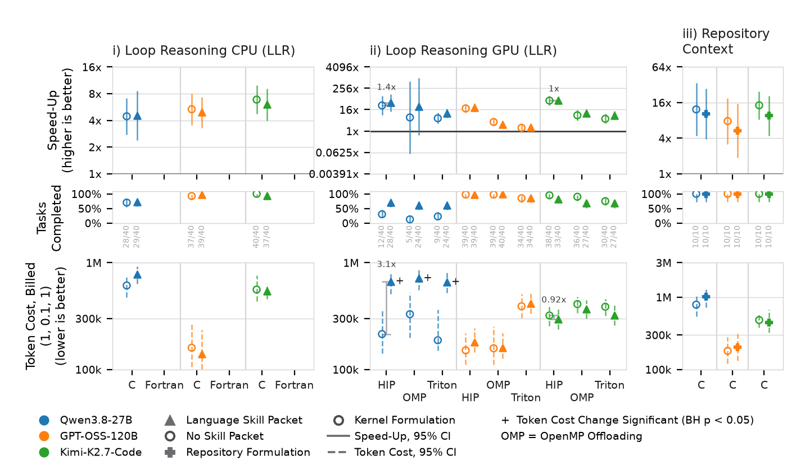
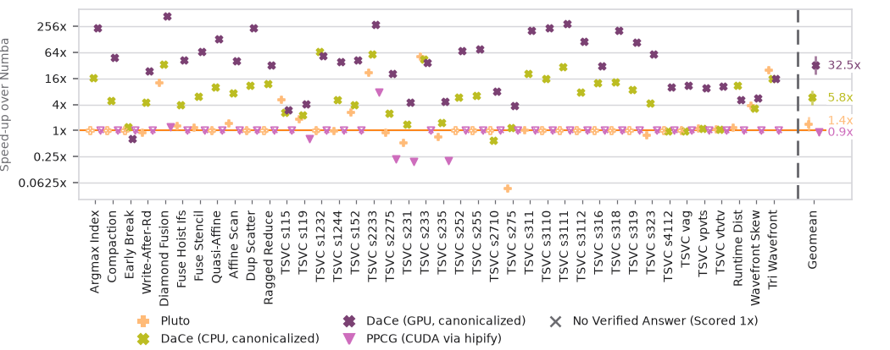

# Plotting

Extract an experiment once, then draw every figure from the extracted observations. Statistics:
[measurement_statistics.md](measurement_statistics.md); token cards: [token_accounting.md](token_accounting.md).

## Design contract

A figure that breaks one of these is wrong.

1. **Library, not script.** Every figure is a function in `hpcagent_bench.stats` (`figures.*`, `summary`,
   `palette`, `style`); `statistics/plot_*.py` only parse arguments. A missing capability goes into the library
   with a test.
2. **Speedup axis = log2 of the ratio** (`summary.log2_change`), ticks labelled in ratios
   (`style.ratio_tick_label`); never ratio - 1, never a bare ratio axis.
3. **Statistics per Hoefler and Belli**, paired per kernel: a speedup is the geomean of per-kernel ratios with a
   95% BCa bootstrap interval (`summary.geomean_ci`); a token cost is an arithmetic mean, a cost change a ratio of
   means with a paired bootstrap interval (`summary.mean_ratio_ci`). Intervals need 6 kernels
   (`summary.MIN_PAIRS_FOR_INTERVAL`). No trend lines; the table carries raw milliseconds and tokens; speedup and
   tokens never share an axis.
4. **Colour = model, shape = treatment**, by name, never by list position:
   - colour is the LLM (`palette.model_color`); several marks of one model wear its shades
     (`palette.model_shade`), its control `palette.CONTROL_SHADE` lighter; compilers take `palette.framework_color`;
   - shape is the treatment from the registry's `shapes:` pool (`palette.harness_marker`, `palette.packet_marker`),
     a packet may pin one with `marker:`; two treatments never share a shape;
   - the control is always the hollow circle `palette.CONTROL_MARKER`;
   - statistic marks use `style`'s neutral inks; no figure carries a hex literal;
   - any other registry entry takes its look from its slot (`palette.look`); an unregistered name gets a stable
     CRC slot. `tests/test_palette.py` pins these rules.
5. **Missing value = hollow cross** at 1x (`population.NOT_DELIVERED`), named in the key and left out of every
   summary; `?` marks data not run yet (`--mark-pending`).
6. **Sizing.** Draw at the placed width (`style.ICLR_TEXT_WIDTH_IN`, `ACM_*`) on `style.PRINT_SCALE`: ticks 7 pt,
   labels 8 pt, keys 6 pt, nothing below 5.5 pt. Save with `style.save(fig, stem, width_in=...)`;
   `statistics/check_paper_figures.py <paper>` checks every figure is placed at scale 1.0.
7. **One legend, below** (`style.legend_below`), naming the interval method, n and the undelivered cross.
8. **Minor ticks** on log and log2 axes and the solved row (`style.minor_ticks`); a count over a fixed tag is a
   census with no interval.
9. **Deliverable** = PDF, a 150 dpi PNG, the CSV behind every mark, and the exact command. A bad figure is shown
   and asked about, never silently redrawn.

Names come from the registry (`study_tags.display_name`, `model_name`, `packet_name`, `framework_name`), Title
Case, without serving details. The baseline is read from the data (`population.one_denominator` refuses a mix).
Tokens come from episode rows, priced with `billed` unless `--cost-model` says otherwise. Values print as `6.3x`
(`style.ratio_label`) and `35.5K` (`style.decade_label`). A connector joins one setup's control and treated marks
(`Pair Link`), never a trend.

## Extract once

```bash
hpcagent-bench extract --runs "$RUN_ROOT/llrblind-*" --setup-prefix llrblind \
    --benchmarks hpcagent_bench/benchmarks --out data/llrblind --db data/observations.db --no-sources
python -m hpcagent_bench.export.dataset --study llr-focus40-blind --regrades "$RUN_ROOT/regrades/*.db" --out data/llrblind.db
python -m hpcagent_bench.export.dataset --study llr40 --db hpcagent-bench-v1-final2.db --out data/llr40.db
```

`--runs` is a repeatable run-root glob; keep waves in a suffix (`<experiment>-w2`) so one prefix matches all of
them, and check the printed summary for missing setups. `--study` extracts a registered study by name;
`--db` reads results databases as one (merged by natural key; a setup two databases hold differently is refused).
Regrade precedence: [measurement_statistics.md](measurement_statistics.md#final-grades-outside-the-judge).

## The figures

| command | figure | library |
|---|---|---|
| `hpcagent-bench plot efficacy` | speedup, solved rate and token cost per comparison | `figures.efficacy.figure_dot_row` |
| `hpcagent-bench plot kernel-speedups` | every kernel of a tag: compiler columns and setups over one baseline, tokens below | `figures.kernel_speedups.kernel_comparison` |
| `hpcagent-bench plot scaling` | distributed track: efficiency, speedup, per kernel, per setup | `figures.scaling` |
| `hpcagent-bench plot kernel-runs` | every run of a designed repeat per kernel and model, conditions side by side | `figures.kernel_runs.kernel_runs_figure` |

Every command takes `-h`; worked examples: [statistics/README.md](../statistics/README.md#examples). Open the PNG
and check the CSV's `solved` and `n` columns before quoting a number.

### Efficacy



One row of panels, each an intervention against its control; rows: speedup (geomean over kernels both setups
solved; `--speedup-over served` puts failures at 1x), solved rate (census), token cost (every served kernel). The
x axis groups by delivery (C | Fortran, HIP | Triton | OpenMP), models side by side.

- `--mode absolute` (default) draws control and treated marks; `--mode relative` draws each treated setup's change
  over its own control, with a band printing the control's absolute level.
- `--mark scatter` (default) or `bar`; `--row-width` sizes the row; `--no-success-row` drops the solved row.
- `*` / `+` mark a significant speedup / token change after Benjamini-Hochberg within the panel.

`--comparison` takes one `key=value;...` spec per panel: `treatment=<packet>` or `pairs=<csv>` (from
`paired_setups.py`), plus `title`, `intervention`, `observations`, `control-label`, `placeholders`, `pending`,
`difference`, `comparators=<csv>` and `comparator-set=pluto:C,...` (compiler marks on the speedup and solved
rows only).

```bash
hpcagent-bench plot efficacy scored.csv blind.csv --pairs-csv blind_vs_scored.csv \
    --intervention no-score --control-label "Score Tool" --out figures/blind.pdf --table data/blind.csv
```

### Per kernel



One row per `--canon-columns` column and per setup of `--experiment` (`<experiment>-<model>-<language>[-<packet>]`,
a combined packet spelled `a+b`; narrowed by `--setups`, a full-match regex, and `--conditions`), every kernel of
`--tag-file` on one axis, tokens below. The summary slot is the geomean over solved kernels and the median of
tokens. `--baseline` changes the denominator (numba for a canon-only figure), `--baseline-fallback` times a kernel
the baseline did not verify, `--include-incomplete` keeps a setup missing kernels, `--offset` spreads a kernel's
rows.

### Kernel runs

Every run (slot) of a designed repeat (`population.designed_runs`) is one dot per kernel and model; conditions
(`-t<T>` temperatures, packet suffixes, the default) are groups side by side, chosen and ordered by
`--conditions t0,default`. Rows: speedup (unsolved hollow at 1x), billed tokens, solved / graded runs. `--style
box` (default: quartiles, whiskers to the extreme runs) or `violin` (a KDE over log10 with the median and its
bootstrap interval). Runs still owed refuse the figure unless `--allow-owed`; `--table` writes per-cell
reliability statistics.

```bash
hpcagent-bench plot kernel-runs data/temperature3.db --experiment temperature3 --tag temperature3 \
    --conditions t0,default --out figures/temperature3_t0_t1.pdf
```

### Scaling

Reads `record == "scaling"` rows (`ranks`, `ranked_ns`, `single_rank_ns`, optional `scaling_mode`, `work_ratio`).
Every point goes through `harness.metric.scaling_point`; a row whose recorded efficiency disagrees is refused, and a
P that could not be measured is a hole listed in `<table>-dropped.csv`. The kernel's own `reference_dist` curve
(`torch_dist`, stored in `reference_scaling_points`) is drawn dashed in grey unless `--no-torch-dist`.

```bash
hpcagent-bench plot scaling data/mlscale20.db --experiment mlscale --figure efficiency --out figures/scaling
```

## A new figure

A function under `hpcagent_bench/stats/figures/` with a test, then a thin script; call `style.apply()` before
importing pyplot, take looks from `palette` and names from `study_tags`, save with `style.save`.
`stats/commands/kernel_speedups.py` is a short example.
